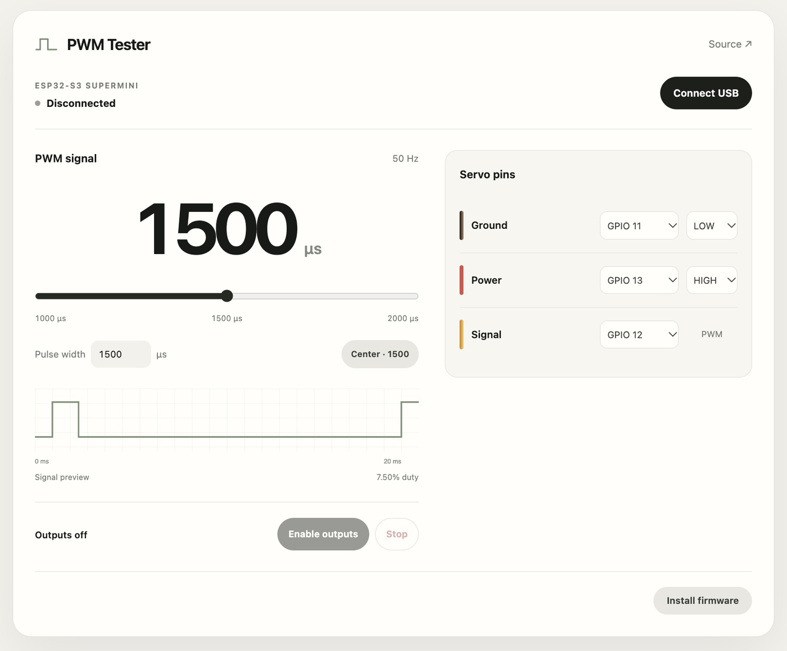

# PWM Tester

[Open PWM Tester](https://qwertpas.github.io/pwmtester/) in desktop Chrome or Edge.

Control an ESP32-S3 SuperMini over USB: 50 Hz PWM with 1000–2000 µs pulses and two configurable digital outputs.

1. Connect the board with a USB data cable. Close other serial monitors.
2. Click **Install firmware** once, then close the installer.
3. Click **Connect USB** and select the Espressif USB serial port.
4. Choose the GPIOs, pulse width, and auxiliary levels, then click **Enable outputs**. Use **Stop** to disable them.

The default PWM signal is **GPIO12**; the two auxiliary outputs are **GPIO13 HIGH** and **GPIO11 LOW**. All three are 3.3 V logic outputs. Power the connected device from a suitable supply and connect its ground to board GND. Do not use the auxiliary outputs as power rails or connect an external supply to them.

Outputs also disable when you disconnect, hide the tab, or change GPIOs. Enable them again to resume.

If installation cannot connect, hold **BOOT**, tap **RESET**, release **BOOT**, and retry. Tap **RESET** after installation if needed.
